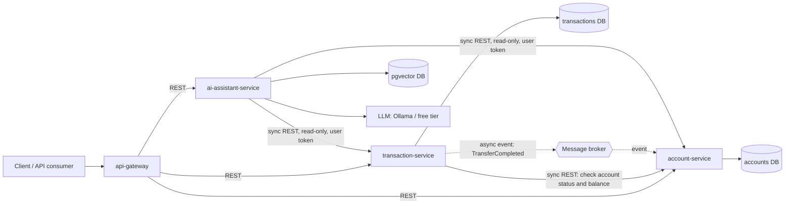

# FinPilot – Architecture

## 1. Architecture styles compared

| Criteria | Monolith | Modular monolith | Microservices |
| --- | --- | --- | --- |
| Deployment | One unit; simple | One unit; simple | Many units; needs Docker and Kubernetes |
| Scaling | Whole app scales together | Whole app scales together | Each service scales on its own |
| Team size fit | Small team | Small to medium team | Medium to large team |
| Data consistency | Easy (one database, local transactions) | Easy (one database, local transactions) | Hard (distributed transactions, Saga) |
| Complexity | Low | Medium | High |
| Failure isolation | Poor (one bug can take down everything) | Poor to fair | Good (a failing service is contained) |

## 2. Decision

**Choice:** microservices.

**Why (reasons that apply to this project):**
1. FinPilot's goal is to demonstrate the skills remote employers ask for: service decomposition, API gateway, event-driven design, Saga, Docker and Kubernetes.
2. The AI assistant has a different lifecycle and resource profile (model calls, vector search) from core banking, so it benefits from being deployed and scaled separately.
3. Separating account data from transaction data lets each service own its schema and be tested and evolved independently.

**Honest trade-offs:**
1. A banking app of this size does not strictly need microservices; a modular monolith would be simpler and faster to build.
2. Transfers now span services and databases, so keeping balances consistent needs the Saga pattern, idempotency and careful failure handling.

**Why not a modular monolith?** It is the pragmatic choice for a small production system. FinPilot deliberately uses microservices as a learning and portfolio project, and the module boundaries below would be the same boundaries inside a modular monolith.

## 3. Services

| Service | Owns | Must never | Database |
| --- | --- | --- | --- |
| api-gateway | Routing, JWT validation, rate limiting | Contain business logic | None |
| account-service | Registration, login, roles, customers, accounts, admin approvals | Store transaction history | PostgreSQL (accounts DB) |
| transaction-service | Deposits, withdrawals, transfers, history, idempotency keys | Create or approve accounts | PostgreSQL (transactions DB) |
| ai-assistant-service | Chat, RAG over banking documents, read-only tool calls | Write to account or transaction data | PostgreSQL with pgvector |

Authentication lives inside account-service for now and can be split into its own service later.

## 4. High-level diagram

Solid arrows are synchronous REST calls. Dotted arrows are asynchronous events.

## 5. Communication rules

- **Synchronous (REST):** balance checks, account status checks, and the assistant's read-only lookups, where the caller needs an answer immediately.
- **Asynchronous (events):** "transfer completed" and similar notifications, where other services react afterwards.
- The AI assistant always calls other services with the **caller's own JWT**, never a privileged service token.

## 6. Open problem: transfer consistency

A transfer between two accounts touches balances owned by account-service and a record owned by transaction-service. There is no single database transaction across them, so a failure halfway could leave money debited but not credited.

Planned approach (Week 4): the **Saga pattern** with compensating actions, an **idempotency key** on every transfer request, and clear transfer statuses (`PENDING`, `COMPLETED`, `FAILED`).

## 7. Open questions to decide

- [ ] Who owns the balance: account-service or transaction-service?
- [ ] Orchestrated Saga (transaction-service coordinates) or choreographed Saga (services react to events)?
- [ ] Kafka or RabbitMQ for the message broker?
