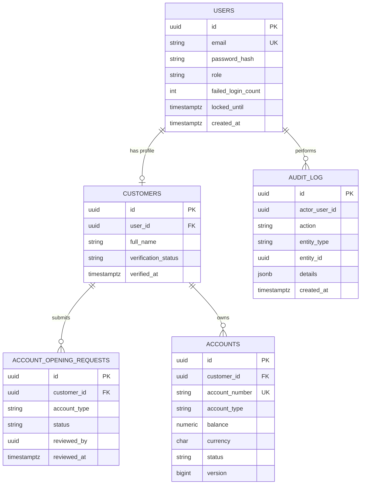
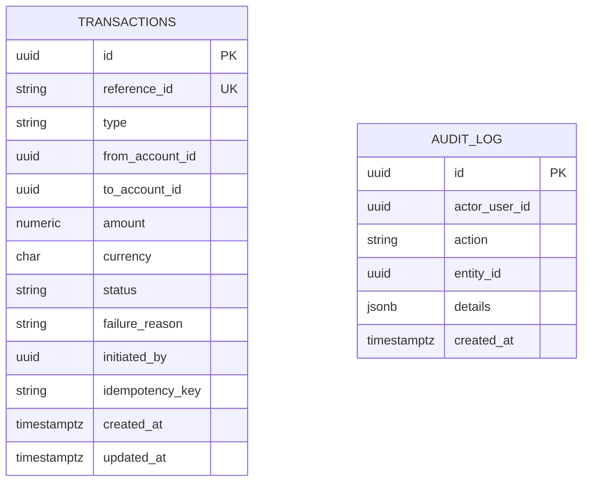

# FinPilot – Database Design

## 1. Decisions

| Decision | Choice | Reason |
| --- | --- | --- |
| Database type | PostgreSQL for all services | Banking data is relational and needs ACID transactions and constraints. NoSQL has no advantage here. |
| Ownership | One database per service; no cross-database foreign keys | Services stay independent. Other services' IDs are stored as plain UUIDs. |
| Who owns the balance | **account-service** owns balances; transaction-service owns the record of what happened | Answers the open question in `architecture.md`. Transaction-service coordinates the transfer Saga and calls account-service to debit and credit. |
| IDs | UUID primary keys | Safe to expose in APIs and safe to generate in any service. |
| Money | `NUMERIC(19,2)` with a currency column; `BigDecimal` in Java | Never floating point. |
| Timestamps | `TIMESTAMPTZ`, stored in UTC | Avoids time zone bugs. |
| Concurrency | `version` column on accounts (optimistic locking) | Prevents two simultaneous updates from overwriting each other. |
| Migrations | Flyway, one `V<n>__description.sql` per change | No schema changes by hand, and no hardcoded seed data in code. |
| Deletes | No deletes of financial records; use status fields | Required for auditability. |

## 2. accounts database (account-service)



### Reference SQL (turn into Flyway migrations)

```sql
-- V1__create_users_and_customers.sql
CREATE TABLE users (
    id                 UUID PRIMARY KEY,
    email              VARCHAR(255) NOT NULL UNIQUE,
    password_hash      VARCHAR(255) NOT NULL,
    role               VARCHAR(20)  NOT NULL CHECK (role IN ('CUSTOMER', 'ADMIN')),
    failed_login_count INT          NOT NULL DEFAULT 0,
    locked_until       TIMESTAMPTZ,
    created_at         TIMESTAMPTZ  NOT NULL DEFAULT now()
);

CREATE TABLE customers (
    id                  UUID PRIMARY KEY,
    user_id             UUID         NOT NULL UNIQUE REFERENCES users (id),
    full_name           VARCHAR(150) NOT NULL,
    verification_status VARCHAR(20)  NOT NULL DEFAULT 'PENDING'
                        CHECK (verification_status IN ('PENDING', 'VERIFIED', 'REJECTED')),
    verified_at         TIMESTAMPTZ
);

-- V2__create_accounts.sql
CREATE TABLE accounts (
    id             UUID PRIMARY KEY,
    customer_id    UUID          NOT NULL REFERENCES customers (id),
    account_number VARCHAR(20)   NOT NULL UNIQUE,
    account_type   VARCHAR(20)   NOT NULL CHECK (account_type IN ('SAVINGS', 'CURRENT')),
    balance        NUMERIC(19,2) NOT NULL DEFAULT 0 CHECK (balance >= 0),
    currency       CHAR(3)       NOT NULL,
    status         VARCHAR(20)   NOT NULL DEFAULT 'ACTIVE'
                   CHECK (status IN ('ACTIVE', 'FROZEN', 'CLOSED')),
    version        BIGINT        NOT NULL DEFAULT 0,
    created_at     TIMESTAMPTZ   NOT NULL DEFAULT now()
);
CREATE INDEX idx_accounts_customer ON accounts (customer_id);

CREATE TABLE account_opening_requests (
    id           UUID PRIMARY KEY,
    customer_id  UUID        NOT NULL REFERENCES customers (id),
    account_type VARCHAR(20) NOT NULL,
    status       VARCHAR(20) NOT NULL DEFAULT 'PENDING'
                 CHECK (status IN ('PENDING', 'APPROVED', 'REJECTED')),
    reviewed_by  UUID,
    reviewed_at  TIMESTAMPTZ,
    created_at   TIMESTAMPTZ NOT NULL DEFAULT now()
);

-- V3__create_audit_log.sql
CREATE TABLE audit_log (
    id            UUID PRIMARY KEY,
    actor_user_id UUID,
    action        VARCHAR(100) NOT NULL,
    entity_type   VARCHAR(50)  NOT NULL,
    entity_id     UUID,
    details       JSONB,
    created_at    TIMESTAMPTZ  NOT NULL DEFAULT now()
);
CREATE INDEX idx_audit_entity ON audit_log (entity_type, entity_id);
```

## 3. transactions database (transaction-service)



`from_account_id`, `to_account_id` and `initiated_by` point to data owned by account-service, so they are plain UUIDs with no foreign key.

```sql
-- V1__create_transactions.sql
CREATE TABLE transactions (
    id              UUID PRIMARY KEY,
    reference_id    VARCHAR(30)   NOT NULL UNIQUE,
    type            VARCHAR(20)   NOT NULL CHECK (type IN ('DEPOSIT', 'WITHDRAWAL', 'TRANSFER')),
    from_account_id UUID,
    to_account_id   UUID,
    amount          NUMERIC(19,2) NOT NULL CHECK (amount > 0),
    currency        CHAR(3)       NOT NULL,
    status          VARCHAR(20)   NOT NULL DEFAULT 'PENDING'
                    CHECK (status IN ('PENDING', 'COMPLETED', 'FAILED')),
    failure_reason  VARCHAR(255),
    initiated_by    UUID          NOT NULL,
    idempotency_key VARCHAR(100)  NOT NULL,
    created_at      TIMESTAMPTZ   NOT NULL DEFAULT now(),
    updated_at      TIMESTAMPTZ   NOT NULL DEFAULT now(),
    CONSTRAINT uq_idempotency UNIQUE (initiated_by, idempotency_key),
    CONSTRAINT chk_accounts CHECK (
        (type = 'DEPOSIT'    AND to_account_id   IS NOT NULL) OR
        (type = 'WITHDRAWAL' AND from_account_id IS NOT NULL) OR
        (type = 'TRANSFER'   AND from_account_id IS NOT NULL AND to_account_id IS NOT NULL
                             AND from_account_id <> to_account_id)
    )
);
CREATE INDEX idx_txn_from ON transactions (from_account_id, created_at DESC);
CREATE INDEX idx_txn_to   ON transactions (to_account_id, created_at DESC);

-- V2__create_audit_log.sql  (same shape as the accounts database)
```

The unique constraint on `(initiated_by, idempotency_key)` is what makes a retried transfer request safe: the second insert fails and the service returns the original result.

## 4. ai-assistant database (pgvector)

- PostgreSQL with the `pgvector` extension, used by Spring AI's vector store.
- Holds only document chunks and their embeddings (the table is created by Spring AI or by a Flyway migration).
- Holds **no customer data**. Customer balances and transactions are fetched live through read-only calls with the caller's JWT.

## 5. Rules for every table

- Primary key is a UUID generated in the application.
- Constraints live in the database (`CHECK`, `UNIQUE`, `NOT NULL`, foreign keys within a service), not only in Java code.
- Every financial or admin change writes an audit log row in the same database transaction.
- No hardcoded reference data in code; use migrations.
- Never log or return `password_hash`.

## 6. Consequences to remember

- A transfer changes two balances in account-service and one record in transaction-service, so consistency across them uses the Saga from Week 4.
- Within account-service, a debit uses optimistic locking (`version`) plus the `balance >= 0` check, so two simultaneous withdrawals cannot overdraw an account.
- Account numbers are generated by the application and must stay unique; the unique index protects against collisions.
